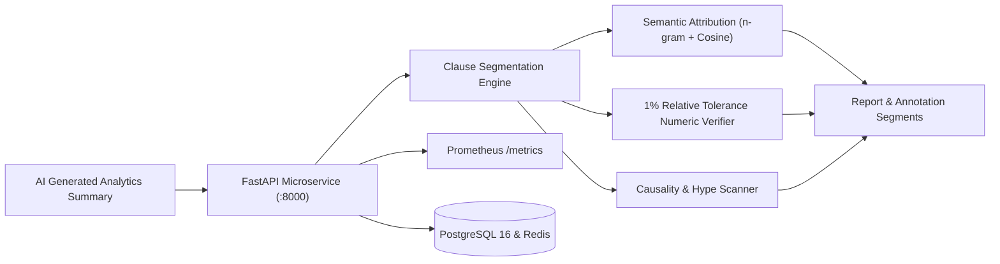
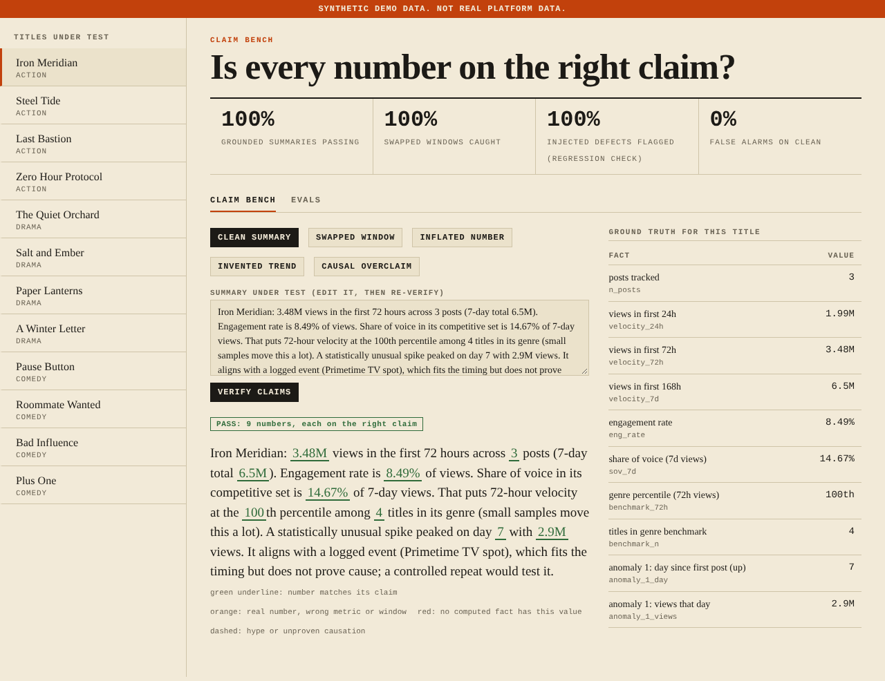
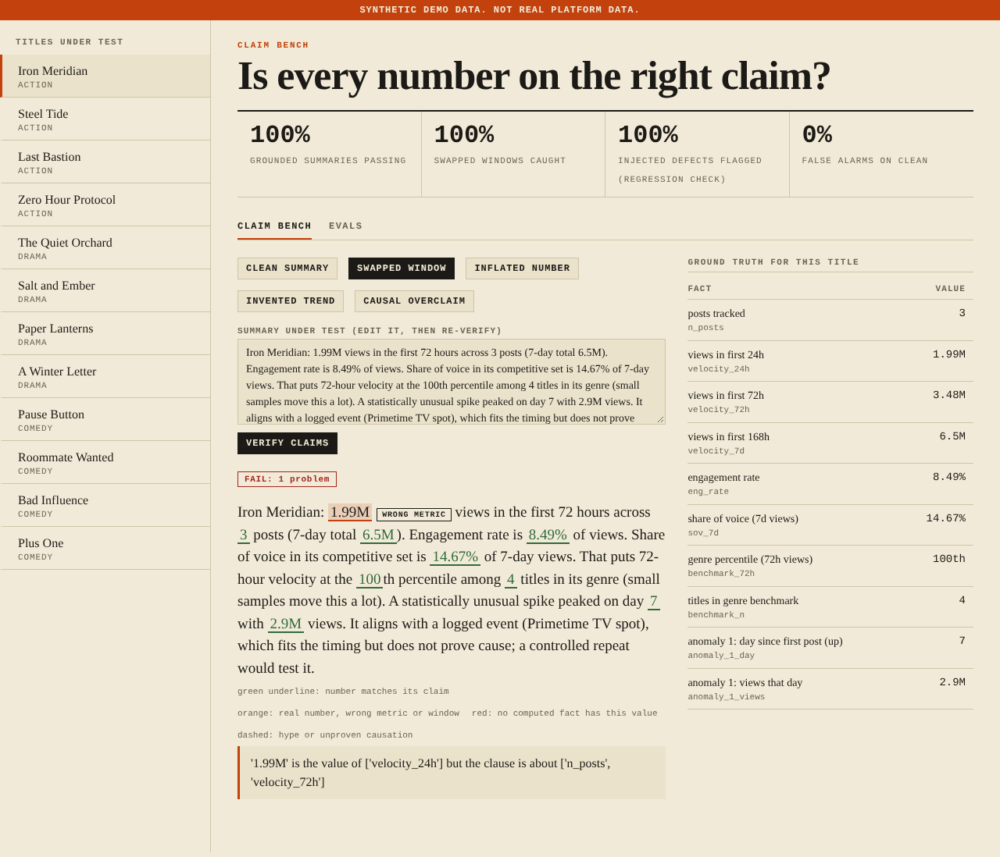
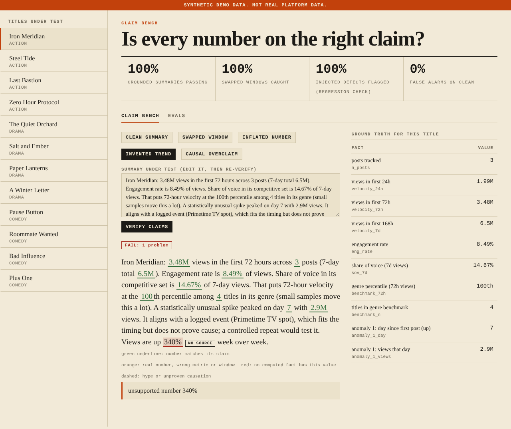
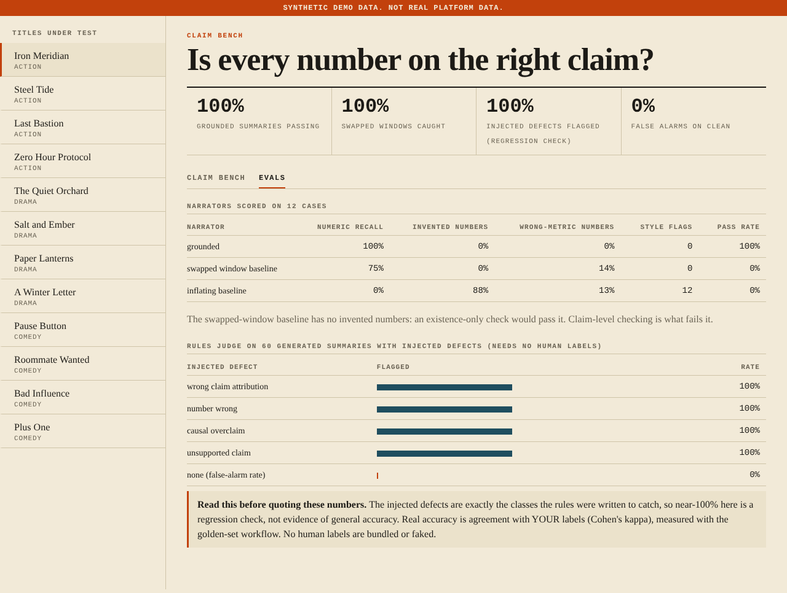
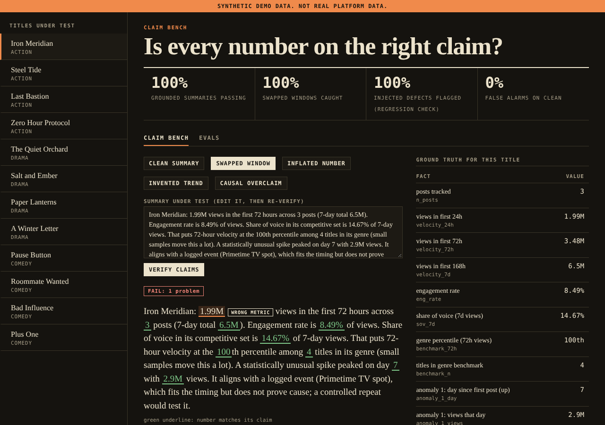
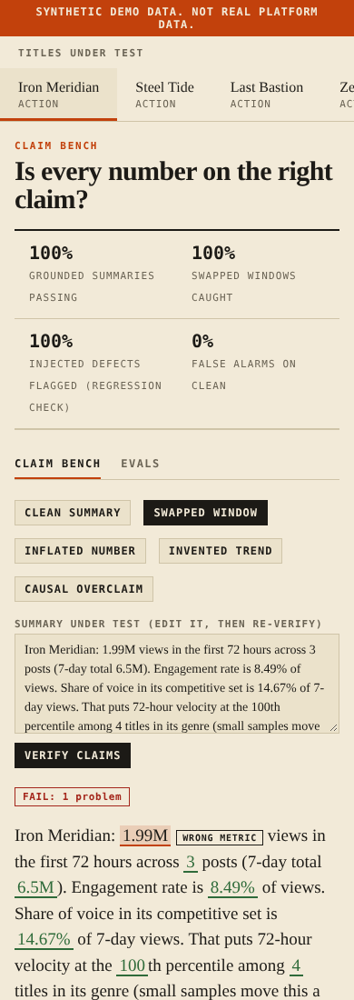
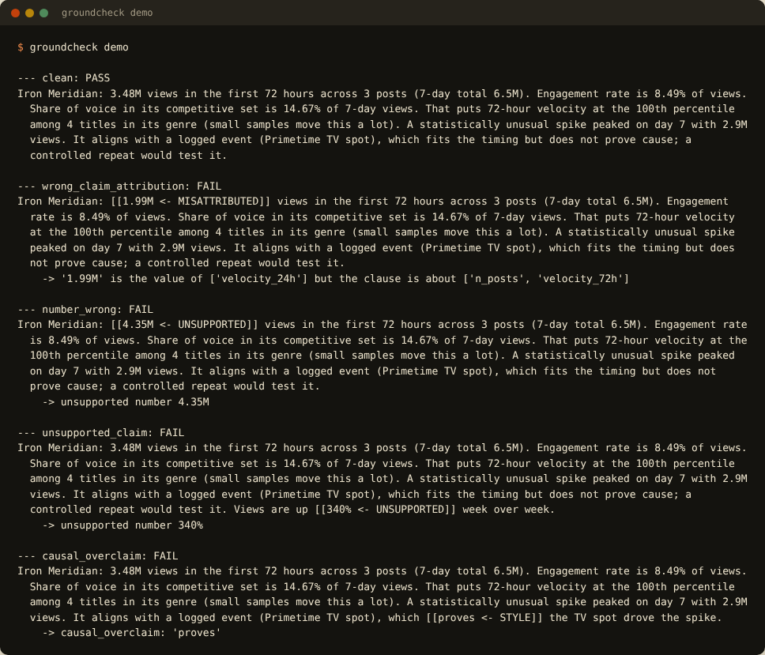
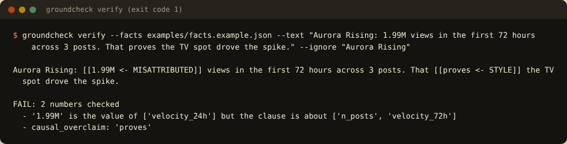
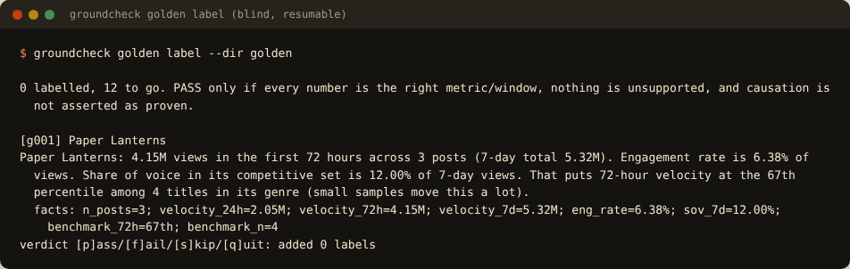

# GroundCheck: Enterprise Claim-Level Verification Platform

[](https://github.com/SriRamkunamsetty/groundcheck-claim-verifier/actions/workflows/ci.yml)
[](https://github.com/SriRamkunamsetty/groundcheck-claim-verifier/actions/workflows/docker-publish.yml)
[](https://github.com/SriRamkunamsetty/groundcheck-claim-verifier/actions/workflows/helm-lint.yml)
[](https://www.python.org/)
[](LICENSE)
[](deploy/helm/groundcheck/)
[](src/groundcheck/api/)

An AI summary can contain only **real** numbers and still be dangerously wrong: the 24-hour figure described as "72 hours". GroundCheck checks that every number is real **and attached to the right metric and window**, then measures how far automated judges agree with *your* labels.

Now elevated to an **enterprise, production-grade cloud-native platform**: featuring **FastAPI**, **AIML semantic claim attribution**, **ML anomaly detection**, **Kubernetes & Helm charts**, **Prometheus/Grafana observability**, and **GitHub Actions CI/CD pipelines**.

---

## Architecture Overview



---

## Screenshots

> **About the screenshots.** All data shown is **synthetic** (the UI says so in an orange banner). Browser images are real captures of this project's own dashboard in Chromium; terminal images are the real stdout of each command, rendered into a terminal-styled page.

### Claim bench: a clean summary


Every number is green: it matches a computed fact and sits in a clause about that fact's metric. Ground truth for the title is on the right.

### Claim bench: the swapped-window error


The same summary with the 24-hour figure described as "72 hours". `1.99M` is a real number, so an existence-only check passes it; claim-level checking flags it as the wrong metric and says which fact it actually is.

### Claim bench: an invented trend


A number no fact supports (`340%`) is marked red.

### Evals


Three narrators scored on 12 cases, and the rules judge on 60 summaries with injected defects. Note the swapped-window baseline has 0% invented numbers: only claim-level checking fails it.

### Dark mode & Mobile
<p align="center">
  
  
</p>

### Terminal: CLI Demo, Verification & Golden Set
<p align="center">
  
  
  
</p>

---

## What It Does (v2.0 Capabilities)

* **Claim-level verifier** (`verify`, `annotate`): Each numeric claim must equal a computed fact *and* sit in a clause about that fact's metric. Flags hype and unhedged causal claims ("proves", "caused by").
* **AIML Semantic Claim Attribution** (`groundcheck.aiml`): Blends deterministic regex cue patterns with vectorized n-gram cosine matching to catch paraphrased metrics and semantic drift without brittle keywords.
* **ML Anomaly Detection**: Robust-Z MAD and Isolation Forest models detecting multi-day viewership surges/drops and correlating them with marketing events.
* **Production FastAPI Service**: High-throughput async REST API with batch verification (`POST /api/v1/verify/batch`), OpenAPI specs, and Swagger UI.
* **Kubernetes & Helm Ready**: Complete Helm 3 chart and raw Kustomize manifests with Horizontal Pod Autoscaling (HPA 2-10 replicas), PodDisruptionBudget, and zero-trust NetworkPolicy.
* **Full Observability Stack**: Native Prometheus `/metrics` exporter tracking request latency, verification throughput, and hallucination rates, with pre-provisioned Grafana dashboards.
* **Adversarial Benchmark Synthesizer**: Generates hard adversarial test suites across 5 defect taxonomies to rigorously calibrate LLM-as-a-judge models.
* **Blind Golden Set & Judge Calibration**: Generates summaries with injected defects, stores the answer key separately for blind human labeling, and computes Cohen's Kappa ($\kappa$) and confusion matrices.
* **Multi-Cloud LLM Adapters**: Zero-dependency resilient HTTP clients with exponential backoff for Anthropic, Gemini, and OpenAI.

---

## Quick Start

### 1. Local CLI & Single-Page Dashboard
```bash
pip install -e ".[all]"

# Launch the production FastAPI service with Swagger UI
groundcheck serve-api --host 0.0.0.0 --port 8000

# Or launch the lightweight vanilla claim bench
groundcheck serve --demo

# Run the terminal demo verifying clean vs 4 defect variants
groundcheck demo

# Verify any summary against an arbitrary facts JSON file (exits 1 on failure for CI/CD)
groundcheck verify --facts examples/facts.example.json --text "Aurora Rising: 1.99M views in the first 72 hours." --ignore "Aurora Rising"

# Run all 37 unit, AIML, and integration tests
python -m unittest discover -s tests -v
```

---

## Cloud-Native Deployment

### Docker Compose (Full Observability Stack)
Launches the GroundCheck FastAPI API, PostgreSQL 16, Redis 7, Prometheus, and Grafana:
```bash
docker compose up -d
```
* **FastAPI Swagger UI**: [http://localhost:8000/docs](http://localhost:8000/docs)
* **Prometheus Metrics**: [http://localhost:9090](http://localhost:9090)
* **Grafana Dashboard**: [http://localhost:3000](http://localhost:3000) (admin / admin)

---

### Kubernetes via Helm
```bash
cd deploy/helm/groundcheck

# Deploy to Kubernetes cluster
helm upgrade --install groundcheck . \
  --namespace groundcheck-prod \
  --create-namespace \
  --set autoscaling.enabled=true \
  --set autoscaling.minReplicas=2 \
  --set autoscaling.maxReplicas=10

# Verify deployment & HPA
kubectl get pods,svc,hpa -n groundcheck-prod
```
See [docs/KUBERNETES.md](docs/KUBERNETES.md) for full instructions, ingress TLS configuration, and GitOps integration.

---

## FastAPI REST Endpoints

| Method | Endpoint | Description |
|---|---|---|
| `GET` | `/healthz` | Kubernetes Liveness Probe |
| `GET` | `/ready` | Kubernetes Readiness Probe (verifies DB & model state) |
| `GET` | `/metrics` | Prometheus Metrics Exposition |
| `POST` | `/api/v1/verify` | Claim verification with semantic attribution |
| `POST` | `/api/v1/verify/batch` | Batch claim verification across multiple texts |
| `GET` | `/api/v1/titles` | List all tracked media titles |
| `GET` | `/api/v1/facts/{title_id}` | Ground truth facts for a title |

### Example API Request
```bash
curl -X POST http://localhost:8000/api/v1/verify \
  -H "Content-Type: application/json" \
  -d '{
    "text": "Aurora: 1.99M views in the first 72 hours across 3 posts.",
    "facts": [
      {"id": "velocity_24h", "label": "24h views", "value": 1990000, "unit": "views"},
      {"id": "velocity_72h", "label": "72h views", "value": 3480000, "unit": "views"},
      {"id": "n_posts", "label": "posts", "value": 3, "unit": "count"}
    ],
    "ignore": ["Aurora"]
  }'
```

**Response:**
```json
{
  "ok": false,
  "n_numbers": 2,
  "claim_accuracy": 0.5,
  "groundedness": 1.0,
  "problems": [
    "'1.99M' is the value of ['velocity_24h'] but the clause is about ['n_posts', 'velocity_72h']"
  ],
  "latency_ms": 1.42
}
```

---

## CI/CD Pipeline

The repository includes enterprise-grade GitHub Actions workflows in `.github/workflows/`:
* **`ci.yml`**: Multi-Python matrix (3.10, 3.11, 3.12) testing, Ruff linting, Bandit SAST security scans, and code coverage.
* **`docker-publish.yml`**: Multi-architecture container build (`linux/amd64`, `linux/arm64`) using Docker Buildx, Trivy vulnerability scanning, and push to GitHub Container Registry (`ghcr.io`).
* **`helm-lint.yml`**: Helm chart linting and dry-run template rendering tests.

---

## Project Structure

```
groundcheck-claim-verifier/
├── .github/workflows/          # CI/CD: Multi-arch Docker, Helm lint, Pytest matrix
├── deploy/
│   ├── docker/                 # Prometheus & Grafana configs
│   ├── helm/groundcheck/       # Production Helm 3 Chart (HPA, PDB, NetworkPolicy)
│   └── k8s/                    # Kustomize / Raw Kubernetes manifests
├── docs/
│   ├── ARCHITECTURE.md         # Detailed C4 & AIML system architecture
│   ├── KUBERNETES.md           # Production K8s deployment & operations guide
│   ├── DESIGN.md               # Verifier rules and mathematical guarantees
│   └── PORTFOLIO.md            # Resume bullets and interview preparation
├── examples/                   # Sample facts and defect summaries
├── src/groundcheck/
│   ├── aiml/                   # Semantic Attribution, ML Anomalies, Adversarial Gen
│   ├── api/                    # FastAPI REST API, Pydantic v2 schemas, Prometheus
│   ├── cli.py                  # CLI commands (verify, demo, eval, golden, serve-api)
│   ├── db.py                   # SQLite + Postgres dual-dialect abstraction
│   ├── metrics.py              # Linear counter interpolation, velocity, anomalies
│   ├── narrator.py             # Clause parser, tolerance matching, style scanner
│   └── web.py                  # Vanilla JS Claim Bench UI server
├── tests/                      # 37 Unit, AIML, API, and Integration Tests
├── Dockerfile                  # Hardened multi-stage non-root container image
├── docker-compose.yml          # Local microservices composition
└── pyproject.toml              # Build config, dependencies, entry points
```

---

## License

Licensed under the [Apache License, Version 2.0](LICENSE).
